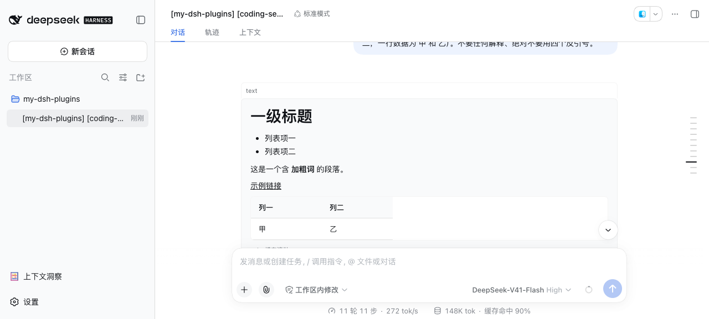

# dsh-md-render

[](https://github.com/topics/dsh)

<div align="center">
  
</div>

**对话渲染插件**：对话里的**围栏代码块全部由本插件自己的渲染器产出** —— 不再调用宿主官方 `MarkdownText` / `CodeBlock`。

- markdown 文本（`text` 家族围栏、**内容确实是 markdown 文档**的无语言围栏、`pre[data-context-text]` 上下文注入块、`MarkdownView`）→ 自研 markdown 渲染（解析层 **marked**，GFM 表格 / 列表 / 标题 / 链接 / 行内代码 / 代码块）；
- 其他语言（`js` / `ts` / `json` / `bash` / `python` …）→ 自研代码块：**语言名胶囊**显示**真实语言名**（不是宿主那个本地化标签「代码块」）+ 复制（hover / focus 浮现）+ 长行横向滚动 + **highlight.js** 语法高亮；
- `mermaid` / `mmd` → 图表卡片（预览 / 代码切换、导出 PNG / SVG、浮窗 + 缩放平移）；
- 另有：整段复制、统一 `MarkdownView` 导出、思考块默认展开、非标准表格容错、设置面板。

> **解析层与高亮层走 `assets/` 懒加载**（与 mermaid 引擎同一模式）：`marked`（47 KB）与 `highlight.js`（129 KB）由 host 半静态托管，client 首次真正需要时才 fetch + 注入 `<script>`，**不进 `lib/client.js`** —— 用户口径「打包体积不用控，只控启动速度」的直接落地。

> 合并包：原 `dsh-think-zh-expand`（思考块）与 `dsh-mermaid-render`（图表）已并入本插件，两个旧包已下线，迁移见 [破坏性变更与迁移](#破坏性变更与迁移)。

## 功能

- **所有围栏块都由自研渲染器接管**（`div.md-code-block`）：
  - 语言 ∈ `text` / `plaintext` / `txt` / `md` / `markdown` → **自研 markdown 渲染**（真实 `h1`–`h6` / `ul` / `ol` / `table` / `blockquote` / `a` / `code` 标签，自有 class + **自有视觉语言**），每块带独立「查看原文」；
  - **确证无语言** → **看内容分流**：明显是 markdown 文档（标题 / 列表 / 表格 / 引用）才 markdown 化；代码 / 日志 / 纯文本 → 代码块（等宽、**保留换行与缩进**）。真实会话实测（2026-10-20 android-monitor，208 个围栏）**200 个没有语言标记**、绝大多数是 Kotlin / SQL / shell 代码 —— 「无标记一律 markdown」会把代码折叠成一坨，因此按内容保守判定，拿不准一律当代码；
  - **无语言块的语言推断**（`markdown.inferLang`，默认开）：先按内容识别（JSON / shell / SQL / Kotlin / Python / TS / JS / Java / C++ / HTML / CSS，只认特征明确的），认不出再用**项目主语言**兜底（host 半 stat 会话 cwd 下的构建标记文件：`build.gradle.kts`→Kotlin、`tsconfig.json`→TypeScript、`go.mod`→Go、`Cargo.toml`→Rust…**不遍历目录、不读文件内容、不跟随符号链接**）；日志块（时间戳行占多数）**不推断**。推断值只用于高亮 + 胶囊展示，带 `data-mdr-lang-inferred` 与悬停「按内容推断 / 按项目推断」，**不冒充围栏原文标注**，也不改变 markdown / 代码的分流。真实会话实测：96 个无语言块里 69 个内容识别命中（Kotlin 62 / SQL 4 / shell 3）、4 个日志留空、23 个走项目兜底；
  - 其他语言 → **自研代码块渲染**：语言名做成**强调色大写胶囊**、复制按钮（默认隐形，hover / 键盘 focus / 触屏才浮现）、**长行横向滚动**（保真，不软换行；官方是 `pre-wrap` + `break-all`）、highlight.js 高亮（hljs 令牌树 → 自有 vdom `span`，**没有 innerHTML**）；
  - `mermaid` / `mmd` → 图表卡片（语言集合不重叠，分流稳定）；
  - 语言识别不出来的块同样接管（代码视图），但**语言位留空**：绝不编造语言名，也绝不把真纯文本误判成 markdown。
- **自有视觉语言（外观也是我们自己的）、markdown 内容以渲染原型为唯一真源**：一套自有设计 token `--mdr-*` 定义**布局 / 形状 / 间距 / 层级 / 边框 / 圆角 / 强调方式 / 动效**，颜色仍取宿主 `--dsw-*` 语义变量（深浅色自适应，**零硬编码色值**）。**markdown 内容（标题 / 段落 / 列表 / 任务框 / 引用 / 表格 / 分隔线 / 行内代码 / 链接 / 图片）逐条对齐 [渲染原型](../../docs/md渲染/概述.md#外观markdown-内容以原型为唯一真源)** —— 几何 / 字号阶梯 / 间距 / 动效取值与原型逐字一致，由 `test/prototype-alignment.mjs` 机器钉死（漂移即红）。辨识点：
  - **强调色胶囊**：代码块语言名（`JS` / `JSON` / `BASH`，大写 + 字距）与图表卡片标题同一形态，官方那是 11px 灰字标签；
  - **统一发丝边框 + 层级圆角**：代码卡片与 markdown 卡片共用 1px 发丝边框（重构原型去掉了代码卡片左侧的 3px 强调竖条），圆角按层级 4/8/10（行内码 / 卡片 / 大卡片）；- **强调色只保留在需要指认的位置**：语言胶囊、图表卡片标题胶囊、引用块左竖线（2px）；
  - **头部不再是通栏灰带**：语言胶囊 + 薄强调底 + 发丝分隔线，与代码区同属一个圆角容器（轻阴影）；
  - **复制按钮 hover / 键盘 focus / 触屏三路浮现**（默认隐形，不占视觉）；
  - **工具条只显示图标**（用户口径）：所有工具条按钮是 **26px 方格图标**，文字走 `data-dsh-md-render-tip` 悬停**浮层**（`::after` 绝对定位 + 向下弹，**零布局位移** —— 旧的「就地撑开」会把同排按钮推开，鼠标扫过整排抖）；复制的成功 / 失败态浮层**常显**（状态不能只靠悬停知道）、触屏按钮就地带文字；**不写原生 `title`**（与浮层重叠显示）；
  - **自有排版尺度**：正文 14px/1.6、标题 **21/17/15/14/13/12**（`h6` 大写小字，阶梯逐字对齐原型）、代码 12.5px/1.7 等宽 —— 不再使用官方 `--dsw-font-markdown-*` 排版 shorthand；
  - **markdown 自有形状（对齐原型）**：`h1`/`h2` 不画竖线与下边框（只靠 18/16/14 字号阶梯与 600 字重分层）、引用块（2px 强调竖线 + 强调薄底 + 7px 右侧圆角，**嵌套引用降级**为中性竖线 + 更淡底）、分隔线（两侧渐隐发丝线）、表格（圆角外框 + **中性表头薄底** + 行 hover 6%）、行内代码胶囊（**宿主发丝描边 + 宿主行内码底** + 强调色文字向正文色收敛保对比度）、列表标记染色 + 有序列表等宽数字、**任务列表勾选框自绘**（**只读**：真实 input 是 disabled + readOnly，勾选态跟随原文 `- [x]` 静态呈现，样式里不写 cursor / :focus-within，防死规则；原生 disabled checkbox 不认 `accent-color`、实测恒为灰 → `appearance:none` + `::before` 画框 + `:has()` 驱动的描边勾形，**勾选走 `rotate(45deg) scale(.6→1)` 150ms 确认动效**，`:has()` 失配时 `@supports` 退化为原生控件）；
  - **自有语法配色 `--mdr-syn-*`**：五色语义映射（蓝=关键字、绿=字符串、琥珀=数值/常量、灰=注释、弱蓝=函数），每色由宿主状态色向正文色混合得到；实测**每个 token 的对比度都不低于官方 shiki 调色板**（官方 `string` 3.30、`comment` 3.18、`parameter` 3.43 均低于 WCAG AA 4.5，本插件对应为 5.57 / 5.08 / 5.55）；
  - **插件自绘 focus 环**：宿主在指针模态下会把官方 `:focus-visible` 描边抹成透明，自有控件因此一律用**强调色 4px 光晕**（`--mdr-focus-ring`；被 `overflow` 裁掉的滚动区用 `-inset` 变体，深色 / 浅色都可见），控件一律 **26px 方格**（对齐原型 §sec-toolbar 的 `.ctl`）；
  - **动效纪律（对齐原型 §D）**：hover 与微状态 150ms、进入 UI 220ms，**只动 `transform` / `opacity`**，动画不作为状态变化的唯一信号；`prefers-reduced-motion` 下全部关掉（不做「缩短到 1ms」的妥协式处理）。
- **围栏语言识别（双源互补 + DOM 兜底）**：主源是 **client 侧的会话事件流索引** —— 从 `ctx.sessions.binding(id).eventSource` 的原始 Session 事件里取 markdown **原文**按内容哈希建表，**天然含历史**，因此**冷启动 / 重启后打开历史会话也命中**，且命中即**零 RPC**；未命中再回落 host 半的**实时围栏语言索引**（订阅 `session/event`，按块内容哈希批量查询）与 **DOM 契约**（`code.language-*` / banner infostring → `js` / `json` / `bash` 等零额外请求）。判定结果带出的 `confirmed` 只用来区分「**确证无语言**」（再按内容分流出 markdown / 代码）与「**识别失败**」（走代码视图、语言位留空）；**只判「是不是 markdown 文档」，绝不猜语言、绝不编造语言名**。
- **「渲染为…」三态切换（所有围栏块可用）**：块内「图表 / Markdown / 源码」控件（hover / 键盘 focus / 触屏三路可达；mermaid 卡片**不**承载它 —— 卡片头的「预览 / 代码」已覆盖「看源码」这条意图，同一意图只留一套入口）；优先级 **手动覆盖 > 语言索引 > DOM 契约**，用于模型把 Java 写成 `js` 这类误判；覆盖值按内容哈希记入 `sessionStorage`，刷新后仍记得。
- **上下文注入块渲染**：宿主把上下文注入正文（**子 agent 回传消息**、AGENTS.md 等）渲染为纯文本 `pre[data-context-text]`；本插件在 DOM 层用**自研 markdown 渲染器**渲染，原文节点保留并置 `hidden`。
- **mermaid 图表卡片**：`mermaid` / `mmd` 围栏块渲染为图表卡片（常驻「预览 / 代码」+ 缩放分段 + **全屏浮窗** +「更多」菜单；导出 PNG / SVG 与缩放模式收在菜单里）；**渲染失败时以原始源码为主**——首屏即源码（可复制），错误原因降为一行灰字并保留「重试」，绝不静默丢内容。引擎 `assets/mermaid-12.2.0.min.js`（npm latest，覆盖 flowchart / sequence / class / state / ER / gantt / pie / mindmap / timeline / kanban / architecture / block / packet / radar / treemap / sankey / xychart / quadrant / requirement / gitGraph / journey / C4 等）由 host 半静态托管，client 首次渲染时按需 fetch，**不内联进 bundle**。
- **图表浮窗 + 缩放 / 平移**：卡片可开**页面内 `<dialog>` 浮窗**（90vw × 85vh + 遮罩，Esc / 关闭按钮 / 点遮罩三路退出，宿主节点原位归还）——**不是**浏览器 Fullscreen API；缩放 / 平移**优先**用 vendored `@panzoom/panzoom@4.6.2`（走 `assets/` 懒加载，对 `lib/client.js` 增量 0），**它拉不起来时自动切内置降级引擎**（纯 CSS `transform`，零运行时加载）—— 任何环境下按钮都必须有反应，**绝不静默丢弃点击**。缩放分段 = **实时百分比 / ±**（− 与 + 夹一个显示值，视觉上算一个控件）；**全屏浮窗 / 适应 / 铺满**收进「更多」菜单：**「适应」是跟随容器的保持态**（全屏 / 窗口 / 容器尺寸变化自动重算，draw.io 的 `Fit Window` 同款），**「铺满」**按容器宽度填满（PhotoSwipe 的 `fill` / Panzoom 的 `cover`），**双击在「适应 ↔ 实际大小」间切换**（键盘 `0` 才是真复位）；缩放锚点**跟随指针 / 手势中心**；进浏览器全屏**先收掉浮窗**（两层容器绝不同时存在）；键盘 `+ - 0` 与方向键、`Ctrl+滚轮`（触控板捏合）、拖拽平移 —— **快捷键与手势全部写进按钮 hover 提示**（此前实现了却没人知道）。
- **预览交互便捷性（对照市面成熟产品取证后补齐）**：代码块**行号切换**（默认关；打开后左侧行号列与代码同字体同字高逐行对齐，**换行态自动让位**——逻辑行会占多行物理行、行号必然错位）、代码块**换行切换**（官方 `CodeToolbar` 有 wrap/unwrap，自研版此前漏掉 = 能力倒退；默认不换行 ⇒ 默认视觉零变化）、markdown **图片点击放大**（原生 `<dialog>` 模态，Esc / 点遮罩 / 点图片三路关闭 + 键盘可达，`src` 仍过 `mdSafeImageSrc` 白名单）。
- **思考块默认展开**：对官方折叠行派发**一次真实 click**，展开动画 / 结构 / a11y 全走官方；用户手动折叠后不再干预。
- **整段 markdown 复制**：官方只有代码块复制；`MarkdownView` 容器带整段复制按钮（**图标按钮**，文字走悬停浮层；复制内容排除代码块 banner 与按钮文案），流式渲染中不显示。
- **统一 `MarkdownView`**：`require('dsh-md-render').MarkdownView`（props `{ text: string }`）＝ 自研渲染 + 表格容错 + 整段复制，供本仓其他插件使用。
- **非标准表格容错**：GFM **不认**的两种写法先规范化再进解析器 —— ① 分隔行完全没有管道符（`a | b` 后跟 `---`）；② 分隔行单元格数与表头不等。**GFM 本来就接受的写法一律不动**（逐条实测证据见 `test/table-normalize.mjs`）。
- **增强开关面板**：全部能力在 设置 → 插件 → 渲染 页签单 tab 三分组可视化编辑，保存即生效、重启不丢。
- **mermaid 围栏闭合即渲染**：流式期间用事件流原文（`assistant/live-chunk` 的 `text-delta`）切片判定围栏是否闭合 —— **闭合那一刻立即渲染图表**，不等整轮消息结束；事件流不可用 / 取不到该内容时退回原有「DOM 语言 + 400ms 稳定窗口」，行为不变。
- **流式安全**：其余块等内容稳定再渲染（`[data-streaming]` 门控 + 400ms 稳定窗口），重扫幂等（签名未变不重建），宿主重渲染后自愈；mermaid 渲染后源码若再变，仍会自动卸载重挂。

## 配置

写入 `cordis.patch.yml` 对应插件行（id `md-render`）的 `config`；设置页保存后同样落盘到 profile patch 文件：

| 配置键                       | 默认   | 作用                                                               |
| ---------------------------- | ------ | ------------------------------------------------------------------ |
| `markdown.copyButton`        | `true` | 整段 markdown 复制按钮（`MarkdownView` 容器）                      |
| `markdown.textFenceMarkdown` | `true` | 围栏块渲染总开关（自研 markdown / 自研代码块；关掉即全部交回宿主） |
| `markdown.contextMarkdown`   | `true` | `pre[data-context-text]` 上下文注入块按 markdown 渲染              |
| `markdown.inferLang`         | `true` | 无语言围栏的语言推断（内容识别 → 项目主语言兜底，带推断标识）      |
| `thinking.defaultExpanded`   | `true` | 思考块默认展开（严格布尔，缺失 / 非法回退 true）                   |
| `mermaid.injectPrompt`       | `true` | 注入 mermaid 能力说明 section（仅显式 `false` 关）                 |
| `mermaid.render`             | `true` | `mermaid` / `mmd` 代码块渲染为图表卡片                             |

> `markdown.*` / `mermaid.*` 是「默认开」语义（仅显式 `false` 关）；`thinking.defaultExpanded` 是严格布尔。非法 / 未知键忽略；配置变更热生效，无需重启。
> `markdown.textFenceMarkdown` 是**沿用下来的键名**（合并前它只管 text 围栏块）—— 现在它是**所有围栏块**的总开关，读兼容不变，避免老 profile 落盘的键失效。

**旧扁平键读兼容**：合并前 `dsh-md-render` 把开关写在 patch 行**顶层**（`copyButton` / `textFenceMarkdown` / `contextMarkdown`），老用户 profile 里已经落盘；读取时顶层旧键映射进对应段（**段内键优先**），**写入一律新结构**。旧 `think-zh-expand` / `mermaid-render` 的顶层 `defaultExpanded` / `injectPrompt` 同样读兼容。

## 路由（host ↔ client 内部契约）

| 路径                                           | 方法       | 用途                                                 |
| ---------------------------------------------- | ---------- | ---------------------------------------------------- |
| `/md-render/api/config`                        | GET / PUT  | 配置读写（归一 + 合并行内已有键后落盘）              |
| `/md-render/api/langs?h=<hash>&h=<hash>…`      | GET        | 围栏语言索引查询（内容哈希 → 语言；单次 ≤64 个哈希） |
| `/md-render/assets/mermaid-12.2.0.min.js`      | GET / HEAD | mermaid 引擎静态资源（ETag / 304 / 405）             |
| `/md-render/assets/panzoom-4.6.2.min.js`       | GET / HEAD | panzoom 缩放 / 平移库静态资源                        |
| `/md-render/assets/marked-18.1.0.umd.js`       | GET / HEAD | **自研 markdown 渲染器的解析层**（MIT）              |
| `/md-render/assets/highlightjs-11.12.0.min.js` | GET / HEAD | **自研代码块渲染器的高亮层**（BSD-3-Clause）         |

上述都是包内 host↔client 私有契约（host 与 client 同包同版本发布，无仓库外消费者），路径来自单一真源 `src/routes/paths.ts`、构建期注入 client 产物，由 `test/route-single-source.mjs` 钉住两侧一致。请求先过 loopback 信任围栏（非本机 → 403）；`langs` 与 `config` 共用 `/md-render/api` 前缀（**不新增第三条路由前缀**）。

`GET /md-render/api/langs` 的响应形如 `{ ok: true, value: { "<hash>": "text" } }`：**只含命中的哈希**（查不到就是识别失败）；非法哈希忽略、超上限截断、非 GET → 405。

> 四个 assets 都**不内联**进 `lib/client.js`（issue #185 的 4.48 MB base64 冗余教训），构建期由 `scripts/build.mjs` 逐文件核对 SHA256（冻结值写在构建脚本里，改内容必须显式更新）+ UMD 形态。
> **新增 assets 后必须重启 `dsh web`**：资源的白名单在 host 半模块加载时就固定了（`lib/routes/assets.js` 的 `ASSET_FILES`），只刷新浏览器不够。

## 破坏性变更与迁移

| 变更                                                                                        | 迁移动作                                                                                                                                                                                                                                                                       |
| ------------------------------------------------------------------------------------------- | ------------------------------------------------------------------------------------------------------------------------------------------------------------------------------------------------------------------------------------------------------------------------------ |
| **内容渲染改为插件自研**（不再调用官方 `MarkdownText` / `CodeBlock`）                       | 无需动作。所有围栏块 + 上下文注入块 + `MarkdownView` 的**渲染结果**由本插件产出；官方节点结构一个字节都不改（只追加自有容器 + 自有 CSS 隐藏官方子树），切「源码」即回到官方视图                                                                                                |
| 新增 assets `marked-18.1.0.umd.js` / `highlightjs-11.12.0.min.js`                           | **重启 `dsh web`**（host 半的资源白名单在启动时固定）；老版本 host 半会把这两个 URL 判成 404 → 插件真降级为「解析层没就绪」，块停在官方形态，不报错                                                                                                                            |
| `dsh-think-zh-expand` / `dsh-mermaid-render` 包下线                                         | 从 profile 的 bundles / roster 删掉 `- id: think-zh-expand`、`- id: mermaid-render` 两行（残留会让 loader 指向不存在的包而启动报错），改用本插件                                                                                                                               |
| 旧路由 `/md/api`、`/think-zh-expand/api`、`/mermaid-render/api`、`/mermaid-render/assets/*` | 不兼容、直接 404：改用 `/md-render/api`、`/md-render/assets`（仅包内契约，无外部消费者）                                                                                                                                                                                       |
| 设置页 3 个 tab → 1 个「渲染」tab（三分组）                                                 | 无需动作                                                                                                                                                                                                                                                                       |
| 配置键扁平 → 命名空间（`markdown.*` / `thinking.*` / `mermaid.*`）                          | **读取兼容**，旧键继续生效；下次保存起落盘为新结构                                                                                                                                                                                                                             |
| 自实现渲染开关（0.3.0 起已下线，0.5.0 起能力回归**自研**）                                  | `syntaxHighlight` / `languageLabel` / `lineNumbers` / `taskList` / `strikethrough` / `image` / `nestedList` / `tableSort` / `tableFold` / `copyButtonPosition` / `codeTheme` 仍不存在（能力由自研渲染器提供，无开关）；patch 里的旧键**保留无害**（被忽略） |

system-prompt section 名保持 `dsh-mermaid-render`（宿主按 name 去重），**非破坏性**；中文思考指令不在此注入，由 dsh-my-memory 的「全局提示词」提供。

## 安装

> 💡 **npm 安装（普通用户推荐）**：`dsh plugin --profile web add dsh-md-render --trust-lockfile`——无需克隆本仓库；以下 link 方式供本仓库开发者使用。

```bash
# 1) 克隆本仓库（任意目录）
git clone https://github.com/baosfeng/my-dsh-plugins.git
# 2) 以本地 link 方式安装（将 <仓库路径> 替换为上面的克隆目录）
dsh plugin --profile web add link:<仓库路径>/plugins/dsh-md-render
```

装完后**重启 `dsh web`**（bundle 层与 assets 白名单都在启动时组合），再硬刷新浏览器。

> 依赖面：产物只 `require` 平台 seed 模块（`react` / `react-dom/client`），**零安装零 external 声明**；自研渲染器的两个依赖（marked / highlight.js）走 assets 懒加载。平台 `react-dom/client` 不可用时走真降级（`MarkdownView` 落 `<pre>`，注入点不动宿主 DOM）。

## 公共 API 契约（semver 承诺）

对外唯一承诺的 API 是 **`MarkdownView`**：`require('dsh-md-render').MarkdownView` 存在且为 React 组件，props 为 `{ text: string }`（额外 props 被忽略，非字符串降级为文本）；bundle id 为 `dsh-md-render`。移除 / 改名 / 必需 props 变更 = major。

**本插件自有 DOM 契约**（跨插件可见；类名或层级变更 = major）：

| 类名 / 属性                                                                                  | 含义                                                                               |
| -------------------------------------------------------------------------------------------- | ---------------------------------------------------------------------------------- |
| `tzx-md`                                                                                     | 自研 markdown 渲染的包裹容器（`MarkdownView` / 围栏块 / 上下文块共用，样式作用域） |
| `dsh-md-render-copy` / `dsh-md-render-copy-done`                                             | 整段复制按钮 / 复制成功态                                                          |
| `dsh-md-render-text-md`（视图值 `markdown`）／`dsh-md-render-text-toggle`                    | 围栏块的 markdown 渲染容器 / 「查看原文」按钮                                      |
| `dsh-md-render-code-host`（视图值 `code`）／`dsh-md-render-code`                             | 围栏块的代码块渲染容器 / 自研代码卡片                                              |
| `dsh-md-render-code-lang` / `dsh-md-render-code-copy`                                        | 代码块 banner 的**真实语言名** / 复制按钮                                          |
| `dsh-md-render-code-pre`（`code` 内为 `hljs-*` span）                                        | 代码主体（长行横向滚动）/ 高亮 token span                                          |
| `dsh-md-render-md-*`（`p` / `h` / `code` / `list` / `table` / `quote` / `left                | center                                                                             | right`） | 自研 markdown 产出的元素上的自有 class |
| `dsh-md-render-lang-switch` / `dsh-md-render-mermaid-vt`（`data-dsh-md-render-lang-force`）  | 「渲染为…」语言手动切换控件 / 覆盖值（`mermaid` \| `markdown` \| `source`）        |
| `dsh-md-render-mermaid-fs` / `dsh-md-render-mermaid-fs-bar`（`data-dsh-md-render-fs-panel`） | 页面内浮窗 `<dialog>` / 浮窗顶栏                                                   |
| `dsh-md-render-seg` / `dsh-md-render-mermaid-zoom-pct`                                     | 缩放分段（− / 百分比 / + 收在一个胶囊）/ 分段里的**百分比显示值**（zoom-math 更新它） |
| `dsh-md-render-menu` / `-menu-item` / `-menu-sep`（`data-dsh-md-render-menu-btn`）         | 「更多」菜单（低频操作的收纳处）/ 菜单项 / 分隔线 / 触发按钮标记                   |
| `data-dsh-md-render-tip`                                                                     | 按钮的**悬停浮层文案**（工具条只显示图标，文字默认收起）；**不写原生 `title`**   |
| `dsh-md-render-context-md`（`data-dsh-md-render-context-body`）                              | 上下文注入块的渲染容器                                                             |
| `dsh-md-render-mermaid-host`（`data-dsh-md-render-mermaid` / `-state` / `-view`）            | mermaid 卡片 host / 状态机标记                                                     |
| `data-dsh-md-render-text-view`（`markdown` \| `code` \| `source`）                           | 围栏块的视图状态（每块独立）                                                       |
| `data-dsh-md-render-text-sig` / `data-signature`                                             | 幂等签名（内容未变不重建）                                                         |
| `dsh-md-render-fallback`                                                                     | 解析层没就绪时 `MarkdownView` 的 `<pre>` 兜底                                      |

**渲染内容的 DOM 由本插件自己的渲染器决定**：官方节点一律不删不改，接管视图下由自有 CSS 隐藏官方子树（`display:none`），切回「源码」即恢复官方原样。其余 exports（`normalizeTables` / `markdownNodes` / `renderMarkdownInto` / `applyFenceBlock` / `highlightCodeNodes` 等）属内部实现面，随重构变动，下游不得依赖。

**外观同样由本插件自己的视觉语言决定**（**不属**上面的类名契约）：`--mdr-*` 设计 token（圆角 / 胶囊 / 强调色 / 线 / 等宽栈 / 语法配色）只在自有作用域内定义与使用，**未对外承诺**，可随版本调整；颜色一律取宿主 `--dsw-*` 语义变量并随深浅色自适应，**不含硬编码色值**。跨插件若要复用这套外观，请引入同一份 CSS 而不是覆盖这些类名。

## 硬约束（机器可校验）

`test/static-assertions.mjs`（DOM 边界）+ `test/own-visual-language.mjs`（**外观自研**：不引用官方 markdown 排版 shorthand / 官方 shiki 调色板、无硬编码色值、自有 token 与辨识点齐全、焦点可见）对构建产物 `lib/client.js` 钉死：**不注册任何 `conversation.chat.node` 节点级 seat**（只 inject `settings.plugins.tab` + `plugins.bundle.config`）、**不读 React fiber 私有属性**、**不对官方元素写 style / class / aria**、**单 MutationObserver**、不含自绘助手节点 / 思考块、不内联 mermaid 引擎、**不再 require 官方 UI 组件库**、自研 markdown / 代码渲染器**没有任何 innerHTML 路径**。

## 已知限制

- **围栏语言识别**（双源互补 + DOM 兜底，**不读 React fiber 私有属性**）：
  1. **client 侧会话事件流索引（主源）**：读 `ctx.sessions.binding(id).eventSource` 的原始 Session 事件（`assistant/message.data.message.content[].text` / `user/message.data.content[].text`，含 `reasoning`，只取 `surfaceOp === 'append'`）解析围栏块，按「规范化代码内容哈希 → 语言」建表；DOM 侧按块 `<pre>.textContent` 算同一哈希查表。**该窗口含历史 → 冷启动 / 重启后打开历史会话也能命中**（host 索引为空时的唯一来源），命中即 **零 RPC**；
  2. **host 半实时语言索引（兜底）**：host 订阅 `session/event` 解析消息 markdown 原文，按「围栏块内容哈希 → 语言」建**有界**索引（2000 条 FIFO、登记**所有**围栏语言、**零磁盘 IO**），client 半按块 `<code>` 内容哈希经 `GET /md-render/api/langs` 批量查询（同一次扫描合成一次请求、结果有缓存、未命中最多重试 2 次后放弃）。**它只覆盖插件进程存活期间产生的消息**（不读历史）；
  3. **DOM 契约（兜底）**：`code.language-xxx` → banner infostring。官方只在**空**围栏分支写 `language-*`，banner 也只对 shiki **认识**的标记显示语言原名，其余显示本地化标签「代码块」。
  - **三者都拿不到语言**（老宿主 / 精简上下文 / 索引为空 / 历史窗口没覆盖到）→ 块仍被接管为**代码视图**（用户口径「所有围栏块都由插件接管」），但**语言位留空**：不写「代码块」、不猜语言、也**绝不**把它误判成 markdown（真纯文本被当 markdown 会走样）；想按 markdown 读，用块内「渲染为… → Markdown」。
  - **确证无语言**（事件流索引明确给出空串）→ 内容像 markdown 文档才 markdown 化，否则按代码卡（判据见 `src/client/parts/fence-content.ts`：markdown 块级特征 ≥ 2 且零代码特征；拿不准一律当代码 —— 误判成代码只是不美化，误判成 markdown 会破坏代码结构）。
  - 主源只覆盖会话事件源**已加载的窗口**：`hasMore` 为真时更早历史里的块没有语言来源 → 走上面那条代码视图降级。同哈希多候选按 DOM 文档序 FIFO，**候选互不相容且 DOM 内同哈希块数与候选数对不上 → 整块放弃猜测**（语言位留空）。
  - 查表只在块**稳定后**（`[data-streaming]` 门控 + 400ms 稳定窗口）发生，且**门控先于语言判定**：流式块与开关关闭的块**一次请求都不发**。会话服务取不到 / 请求失败 / 无 `fetch` 一律静默降级。
- **语言索引的服务依赖**：用 `ctx.get('sessions', false)` **惰性**取会话服务（cordis 4 的 `ReflectService.get` 契约即「read a service without the inject requirement」，与设置页取 `slots` 同款写法），**刻意不声明 `inject: ['sessions']`** —— 硬 inject 在服务缺失时会让整个 client 半**根本不 apply**（连样式与设置页一起失效）。**零新增硬依赖。**
- **解析层 / 高亮层是懒加载的**：页面首次需要时 fetch 并注入 `<script>`，因此**首屏到「接管」之间有一个微任务 + 一次同源请求的窗口**（期间块保持宿主官方形态，就绪通知后自动补渲染）；加载失败按会话缓存（不再重试），块停在宿主官方形态，不报错。
- **官方 `react-dom/client` 不可用**（极旧或裁剪宿主）：DOM 注入点不动宿主 DOM，`MarkdownView` 落 `<pre>` 兜底。
- **单块超长**保持宿主原样：markdown 围栏块 > 10 万字符、代码块 > 20 万字符（其中 > 6 万字符只跳过高亮、内容照常渲染）、上下文注入块 > 20 万字符、mermaid 源码 > 5 万字符。
- 表格容错只覆盖上述两种写法（纯空格分隔、缺分隔行等「不是表格」的写法不会渲染为表格）。
- **raw HTML 永远是字面文本**（与官方 `MarkdownText` 同口径）：模型输出不会被当 HTML 执行；链接只放行 `http` / `https` / `mailto` 与同源相对路径，图片只放行 `http(s)` 与同源相对路径（其余渲染 alt 文本）。
- **思考块默认展开**是 DOM 层派发点击（官方没有任何扩展点）；选择器失配（宿主升级改属性）时静默退回官方默认。
- **外观是插件自己的、不承诺跨版本稳定**：`--mdr-*` 设计 token 与具体字号 / 圆角 / 间距会随视觉迭代调整（类名契约不变，见「公共 API 契约」）。颜色取自宿主语义变量，因此**极端自定义主题**下若宿主别名色本身对比度不足，本插件也只会给出同样不足的观感（语法配色已按「向正文色混合」尽量保底，实测不低于官方 shiki 调色板）。代码块**长行横向滚动**（不软换行）是有意的保真取舍：与官方 `pre-wrap` + `break-all` 的换行口径不同，超长单行需要横向拖动查看。

## 相关文档

→ [md 渲染模块文档](../../docs/md渲染/概述.md) · [CHANGELOG](CHANGELOG.md)
