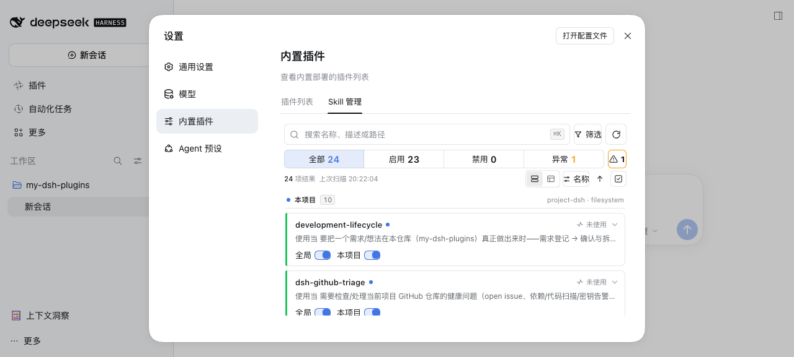

# dsh-my-skill-manager

> **DSH Skill 管理插件**：一页看清全部 skill（来源 / 启用状态 / 使用热度），全局与本项目两个作用域直接启停，支持搜索筛选排序、详情与 SKILL.md 只读预览、批量启停、扫描诊断。**禁用即不注入会话：模型不可见、不可加载。**

[](https://www.npmjs.com/package/dsh-my-skill-manager)



> 上图为真实宿主环境截图（设置 → 插件 → Skill 管理）。

## 功能

- **全量目录**：官方 skill catalog 与目录扫描合并，显示名称、描述、来源、provider、路径、是否被收录；目录存在但未被收录的条目单独标记「未收录」并说明不注入。
- **双作用域启停**：每个 skill 上「全局」「本项目」两个开关并排——全局禁用对所有项目生效，本项目禁用只影响当前项目；状态徽标区分「生效 / 全局已禁用 / 本项目已禁用 / 未收录」。
- **搜索与组织**：按名称/描述/路径搜索，来源与状态筛选、只看未使用、四种排序（名称 / 使用次数 / 最近使用 / 来源）。
- **卡片流 / 紧凑表**：两种视图共享筛选与展开状态；紧凑表支持表头排序与多选。
- **详情**：路径（可复制）、provider、调用能力（模型可调用 / 用户可调用）、来源、使用统计；SKILL.md 只读预览（前 15 行，可展开复制全文）。
- **批量启停**：进入选择模式后批量启用/禁用，破坏性操作内联二次确认。
- **扫描诊断**：坏符号链接、缺 SKILL.md、frontmatter 异常等条目独立诊断台，含原因、建议与可复制路径。
- **使用统计**：次数、最近使用时间与来源（model / user），持久化于 `$DSH_HOME/skills.usage.json`。
- **重新扫描**：新建 skill 后点「重新扫描」立即可见，无需重启。

## 安装

```bash
# npm 安装（推荐）
dsh plugin --profile web add dsh-my-skill-manager --trust-lockfile

# 本地 link（本仓库开发者）
git clone https://github.com/baosfeng/my-dsh-plugins.git
dsh plugin --profile web add link:<仓库路径>/plugins/dsh-my-skill-manager
```

## 配置

启用状态存 JSON，改动即时生效（catalog 自动失效重算）：

```jsonc
// 全局：$DSH_HOME/skills.enabled.json；项目：<项目根>/.dsh/skills.enabled.json
{
  "global": { "disabled": ["some-global-skill"] },
  "project": { "disabled": ["web-search"] },
}
```

- `global.disabled`：全局禁用（所有项目生效）；
- `project.disabled`：当前项目禁用（可禁用项目级与全局级 skill）。

## 接口

插件在 `/my-skill-manager/api` 下提供页面所需数据（信任围栏保护）：

| 方法 | 路径 | 说明 |
| --- | --- | --- |
| GET | `/list?cwd=` | 全量 skill + 两个禁用名单 + 诊断 + 使用统计 |
| GET | `/detail?name=&cwd=` | SKILL.md 只读正文（白名单根、≤256KB） |
| GET | `/rescan?cwd=` | 让官方目录失效重算后返回列表 |
| GET | `/session?sessionId=` | 会话工作目录 |
| PUT | `/config` | 保存某作用域的禁用名单 |

## 边界

- 禁用按名字生效：同名的任何来源 skill 都会被占位覆盖；
- 项目配置以 cwd 向上找最近 `.git` 定位项目根，无 `.git` 时退回 cwd 自身；
- 详情只读扫描白名单根内的 `SKILL.md`，路径 realpath 校验、超 256KB 截断；
- 只扫描插件可确定的默认 skill 根目录，宿主自定义目录不纳入（宁可漏报也不误报）。

## 相关文档

→ [Skill 管理概述](../../docs/Skill管理/概述.md) · [重设计原型](../../docs/原型重构/dsh-my-skill-manager.html) · [实现契约](../../docs/原型重构/impl-contract-skill-manager.md)
